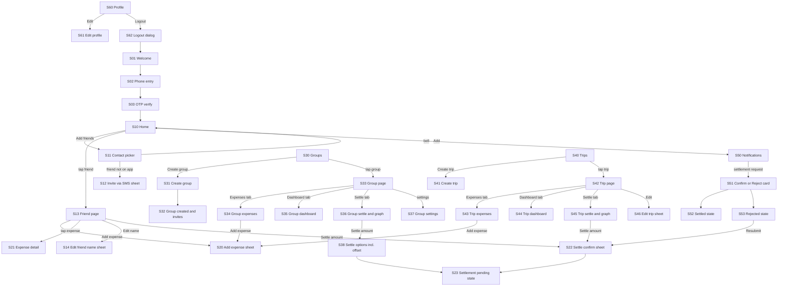

# SplitUp: APP_FLOW.md

> Screen inventory and navigation map for the SplitUp Android app.
> Read with `PRD.md` (rules), `DESIGN.md` (visuals), `ARCHITECTURE.md` (go_router setup) and `PHASES.md` (build order).
> **For the agent:** every screen below must exist as a route in `core/routing`. Navigation must match this file exactly. Where a screen exists in the Stitch project, use the name in the **Stitch screen** column to fetch it; if the column is blank, the screen was not designed yet: build it from `DESIGN.md` patterns and tell the user.
> **👤 USER:** fill in the **Stitch screen** column with your exact screen names from your Stitch project before giving this file to the agent.

---

## 1. Conventions

- **Screen ID** (`S01`...) is stable. Use it in code comments and tasks.
- **Route** is the `go_router` path. `:id` values are opaque server ids.
- **Shell** = inside the bottom-nav shell (nav bar visible). **Deep** = outside the shell (nav bar hidden).
- **Type**: `Screen`, `Sheet` (bottom sheet), `Dialog`, `State` (a visual state of another screen, not a separate route).
- "Back" always returns to the previous screen in the stack unless stated.
- Notification taps deep-link to a route with the needed ids (section 6).
- Money rules shown here are summaries. `PRD.md` decides behavior.

### Global rules (apply to every screen)
1. **Settle button rule:** the **Settle (amount)** button appears only on a row where the current user must pay. Never on a row where the user receives money.
2. **Name rule:** every person's name comes from `displayNameFor()` (nickname, then contact name, then profile name).
3. **Trips are isolated.** No trip amounts appear on any friend, group or profile balance rows other than the profile's overall totals as defined in `PRD.md`, and no offset UI exists in trips.
4. **Bell icon** with unread badge appears on the top bar of S10 Home, S30 Groups and S40 Trips only.
5. **Every list screen** has loading, empty, error and offline states (section 8).
6. **Theme:** all screens support light, dark and system modes.

---

## 2. Navigation Structure

```
App start
 ├─ Session check
 │   ├─ not signed in           → Welcome (S01)
 │   ├─ signed in, no phone OTP → Phone entry (S02)
 │   └─ signed in and verified  → Home (S10)
 │
 └─ Bottom-nav shell (visible only on these 4 root screens)
     ├─ Home (S10)       /home
     ├─ Groups (S30)     /groups
     ├─ Trips (S40)      /trips
     └─ Profile (S60)    /profile

 Top-right bell on S10, S30, S40 → Notifications (S50)
```

### Overview diagram



---

## 3. Screen Inventory

| ID | Screen | Type | Route | Shell/Deep | Stitch screen |
|---|---|---|---|---|---|
| S01 | Welcome (Google / email) | Screen | `/welcome` | Deep | |
| S02 | Mobile number entry | Screen | `/auth/phone` | Deep | |
| S03 | OTP verification | Screen | `/auth/otp` | Deep | |
| S04 | Merge explainer (first launch after placeholder merge) | Sheet/Screen | `/welcome-back` | Deep | |
| S10 | Home (summary + friends) | Screen | `/home` | Shell | |
| S11 | Contact picker / search (Add friends) | Screen | `/friends/add` | Deep | |
| S12 | Invite via SMS popup | Sheet | (sheet over S11/S13/S32/S41) | n/a | |
| S13 | Friend page | Screen | `/friends/:friendId` | Deep | |
| S14 | Edit friend name | Sheet | (sheet over S13) | n/a | |
| S20 | Add / edit expense | Sheet | `/ledgers/:ledgerId/expenses/new` | Deep | |
| S21 | Expense detail (activity log, Dispute) | Screen | `/ledgers/:ledgerId/expenses/:expenseId` | Deep | |
| S22 | Settle confirm (sender) | Sheet | (sheet) | n/a | |
| S23 | Settlement pending state | State | (state of S13/S36/S45 row) | n/a | |
| S30 | Groups list | Screen | `/groups` | Shell | |
| S31 | Create group | Screen | `/groups/new` | Deep | |
| S32 | Group created, invite list | Screen | `/groups/:groupId/created` | Deep | |
| S33 | Group page (tab host) | Screen | `/groups/:groupId` | Deep | |
| S34 | Group Expenses tab | Tab | `/groups/:groupId?tab=expenses` | Deep | |
| S35 | Group Dashboard tab | Tab | `/groups/:groupId?tab=dashboard` | Deep | |
| S36 | Group Settle tab (list + graph) | Tab | `/groups/:groupId?tab=settle` | Deep | |
| S37 | Group settings | Screen | `/groups/:groupId/settings` | Deep | |
| S38 | Settle options (cash/UPI, use individual balance) | Sheet | (sheet over S36) | n/a | |
| S40 | Trips list | Screen | `/trips` | Shell | |
| S41 | Create trip | Screen | `/trips/new` | Deep | |
| S42 | Trip page (tab host) | Screen | `/trips/:tripId` | Deep | |
| S43 | Trip Expenses tab | Tab | `/trips/:tripId?tab=expenses` | Deep | |
| S44 | Trip Dashboard tab (budget meter) | Tab | `/trips/:tripId?tab=dashboard` | Deep | |
| S45 | Trip Settle tab (list + graph) | Tab | `/trips/:tripId?tab=settle` | Deep | |
| S46 | Edit trip (name, budget slider, dates, complete) | Sheet | (sheet over S42) | n/a | |
| S50 | Notifications feed | Screen | `/notifications` | Deep | |
| S51 | Settlement / offset request (receiver) | Card/Sheet | `/settlements/:settlementId` | Deep | |
| S52 | Settled result state | State | (state of S51) | n/a | |
| S53 | Rejected / Outdated state (sender) | State | (state of S13/S36/S45 row, S50 item) | n/a | |
| S60 | Profile | Screen | `/profile` | Shell | |
| S61 | Edit profile (name, photo, email) | Screen | `/profile/edit` | Deep | |
| S62 | Logout confirmation | Dialog | (dialog) | n/a | |
| S63 | Blocked users | Screen | `/profile/blocked` | Deep | |
| S64 | Notification preferences | Screen | `/profile/notifications` | Deep | |
| S65 | Delete account | Screen/Dialog | `/profile/delete` | Deep | |
| S66 | Update available / required | Banner/Screen | (banner on S10; blocking screen `/update-required`) | n/a | |

**Settlement graph** is part of S36 and S45 only. It is not shown for individual (1-to-1) friend pages.

---

## 4. Screen Specifications

For each screen: purpose, key elements, actions and destinations, conditions, states.

### 4.1 Onboarding

**S01 Welcome**
- Purpose: entry for signed-out users.
- Elements: coin-split logo, tagline, "Continue with Google", "Continue with email", terms and privacy text.
- Actions: Google or email success then S02 if the phone is not verified, else S10.
- States: loading while authenticating; error snackbar on failure.

**S02 Mobile number entry**
- Elements: country code (default +91), number field, "Send OTP".
- Action: Send OTP then S03. Number is normalized to E.164 before sending.
- Cannot be skipped. System back exits the app (no way into the app without verification).

**S03 OTP verification**
- Elements: 6-box OTP input, resend with countdown, "Change number".
- Action: success then S04 if a placeholder merged, else S10.
- States: wrong code, expired code, too many attempts.

**S04 Merge explainer** (only if a placeholder was merged)
- Elements: "Priya has added you to N expenses totalling Rs Y", list of the people who added them.
- Action: "Continue" then S10.

### 4.2 Home and friends

**S10 Home** (Shell, tab 1)
- Top bar: title or greeting, bell with badge (then S50).
- Hero wallet-card: You are owed, You owe, Net.
- Search field and **Add friends** pill (then S11).
- Friends list: avatar, display name, "Not on app" tag if applicable, signed amount with "owes you" or "you owe", "Settled" if zero.
- Tap friend then S13.
- Update banner (S66) if a newer version exists.
- States: empty (no friends: coin mark, "Add your first friend", button to S11), loading, error, offline.

**S11 Contact picker**
- Entry: Add friends from S10 (also reused by S31 and S41 for member selection).
- On open: request contacts permission with a short explanation. If denied, show manual entry (name and phone).
- Elements: search, contact list with checkboxes, "On SplitUp" and "From your contacts" sections, "Add" button.
- Action **Add**:
  - Selected contact is an app user: added immediately, in-app notification sent to them, back to S10 with a confirmation snackbar.
  - Not an app user: added as placeholder, then **S12** shown for each non-user.
- Already a friend: show "Already in your friends" and do not duplicate.

**S12 Invite via SMS popup**
- Elements: friend name, short explanation, **Invite via SMS** button, "Not now".
- Action: opens the device SMS app with the preset message (see `PRD.md` FR-8). Cannot detect whether it was sent. The friend card shows "Not on app. Invite again", which reopens this sheet.

**S13 Friend page**
- Header: avatar, display name, small grey "Profile name: ..." if a nickname is set, edit-name icon (then S14).
- Summary glass panel: who owes whom and the amount.
- **Settle (amount)** button only if the current user pays (then S22).
- Pending settlement row shows a **Pending** chip (S23) and a Cancel action for the sender.
- Rejected or Outdated shows the S53 state with **Resubmit**.
- "Also in:" chips listing shared groups and trips (labels only, tap goes to that group or trip).
- Expense list grouped by date. Tap then S21.
- Floating **Add expense** (then S20).
- If the friend is a placeholder: "Not on app. Invite again" banner (S12).
- Overflow menu: Remove friend (blocked while unsettled balance exists), Block.

**S14 Edit friend name (sheet)**
- Field prefilled with the current display name, "Reset to contact name", Save. Shows "Profile name: ...". Private to the user.

### 4.3 Expenses

**S20 Add / edit expense (sheet)**
- Entry: from S13 (individual ledger), S34 (group), S43 (trip).
- Order: amount (huge input with keypad), title, category row, **Paid by** (one or more payers with amounts), **Split** segmented control (Equal, Exact, Percent, Shares), member list with checkboxes and **Not there** toggle, live per-person line, Save.
- Individual ledger: members are the two people (the "Not there" toggle is not needed and is hidden).
- Validation: payer amounts sum to total; exact amounts sum to total; percentages sum to 100; at least one participant.
- Save then back to the origin with the updated list.

**S21 Expense detail**
- Receipt-style card: title, total, category, date, payers, each person's share, note.
- Activity log (who created or edited and when).
- Actions: Edit, Delete (creator or group admin), **Dispute** (any participant, not the creator).
- Disputed expenses show a "Disputed" chip.

### 4.4 Settlements

**S22 Settle confirm (sender sheet)**
- Elements: "You pay <name> Rs X", amount field (partial allowed, not more than owed), method (Cash, UPI, Other), **Settle** button.
- Action: creates the request and notifies the receiver, then S23.
- Individual and trip contexts have no offset option. Group context uses S38 instead.

**S23 Pending state**
- The row shows "Pending confirmation from <name>" with a dashed arrow in graphs, and a Cancel link for the sender.
- Pending requests do not change balances.

**S38 Settle options (group only)**
- Same as S22, plus **Use individual balance** when an opposite individual balance exists: shows exactly what is offset ("Rahul owes you Rs 60 individually, Rs 60 will be offset, Rs 40 to pay"). Creates one offset request, then S23.

**S51 Settlement / offset request (receiver)**
- Elements: "<name> says they paid you Rs X", method and time, for offsets the two linked ledgers shown clearly.
- Only **Confirm** and **Reject** buttons.
- Confirm then S52. Reject then S53 for the sender.
- If invalid by the time it opens, the screen shows "This request is outdated" and no buttons.
- Placeholder receiver: the placeholder's creator sees the request with an "on behalf of <name>" label and confirms for them; the result is **self-confirmed (unverified)**.

**S52 Settled state**
- "Confirmed" result with the coin-split check, balance updates, back to origin.

**S53 Rejected / Outdated state (sender)**
- Row or notification shows "Rejected by <name>" or "Outdated". Button **Resubmit**:
  - Rejected: prompt "Resubmit as is, or change the amount?"
  - Outdated: prefilled with the current valid amount.
  - If nothing is due: "No amount due anymore", no button.

### 4.5 Groups

**S30 Groups list** (Shell, tab 2)
- Top bar: title, bell. WhatsApp-style rows (overlapped avatars, name, last activity, my balance in emerald or terracotta). Floating **Create group** button (then S31). Tap a group then S33.
- Empty state: "Create your first group".

**S31 Create group**
- Group photo and name, "You will be the admin", selected-member chips, search, contact and friends list, bottom **Create group** (enabled with a name and at least one member).
- Reuses the S11 picker logic.
- Success then S32.

**S32 Group created, invite list**
- "Group is ready", list of non-app members with **Invite** buttons (S12 per person, "Invited" is shown only as a local marker), **Go to group** (S33), Skip.

**S33 Group page** (tab host)
- Top bar: back, group name, settings icon (S37). Tabs: **Expenses**, **Dashboard**, **Settle**.
- Floating **Add expense** on the Expenses tab.

**S34 Group Expenses tab**
- Expense list grouped by date, search, tap then S21. Empty state "No expenses yet".

**S35 Group Dashboard tab**
- Donut chart by category, paid-vs-share bars per member, spending-over-time line. Empty state when no expenses.

**S36 Group Settle tab**
- Segmented control: **Simplified / Actual**.
- Node-and-link graph (see section 7), text list of settlements below.
- **Settle (amount)** only on rows where the current user pays (then S38).
- Pending links are dashed. Tap a node to highlight its links. Tap a link for a details sheet.
- Empty state: "All squared up." when every balance is zero.

**S37 Group settings**
- Members list with roles. Admin only: rename, change photo, add member (S11), remove member, delete group.
- Any member: leave group.
- Leave or remove is blocked with a clear message if that person has unsettled balances.

### 4.6 Trips

**S40 Trips list** (Shell, tab 3)
- Top bar: title, bell, small **+** create button (then S41). Segmented control **Active / Completed**. Trip cards: name, dates, member avatars, slim budget line. Tap then S42.
- Empty states for each segment.

**S41 Create trip**
- Fields: trip name, budget (mono amount input, required), optional dates.
- Members: **Add from a group** chip row (copies the members), search over friends and contacts, selected avatar chips (removable).
- Non-app members get the invite list afterwards (S12 per person).
- **Create trip** then S42.

**S42 Trip page** (tab host)
- Top bar: back, trip name, **Edit** (S46). Tabs: **Expenses**, **Dashboard**, **Settle**. Floating **Add expense** on Expenses.

**S43 Trip Expenses tab**
- Same list pattern as S34.

**S44 Trip Dashboard tab**
- **Budget gauge** with level colors: under 60 percent emerald, 60 to 80 brass, 80 to 100 amber, over 100 terracotta with "over budget by Rs X".
- **Budget slider** next to the gauge with an editable number field (creator only; others see read-only).
- "Rs X per day left" when dates exist.
- Category donut, daily spending bars.

**S45 Trip Settle tab**
- Same as S36. No offset option anywhere. Settle (amount) then S22.

**S46 Edit trip (sheet)**
- Rename, budget, dates, **Mark as completed** (creator). A completed trip moves to the Completed segment and still allows settlements.

### 4.7 Notifications

**S50 Notifications feed**
- Grouped Today / Yesterday / Earlier. Unread dot. "Mark all as read".
- Actionable items with inline **Confirm / Reject** (settlements, offsets) and **Remove / Block** (friend adds).
- After acting, the item shows the result and stays.
- Tapping a non-action item deep-links (section 6).
- Empty state: "You're all caught up."

### 4.8 Profile

**S60 Profile** (Shell, tab 4)
- Avatar with camera badge, name, email, phone (read-only). Summary panel: **You owe**, **You are owed**, net.
- Rows: Edit profile (S61), Appearance (Light, Dark, System segmented control, applies immediately), Notifications (S64), Blocked users (S63), Help and feedback, App version, Delete account (S65). **Log out** at the bottom (S62).
- No bell icon on this screen.

**S61 Edit profile**
- Name, photo (gallery or camera, circular crop, remove falls back to initials), email (re-verification step). Phone is read-only.

**S62 Logout dialog**
- "Log out of SplitUp?" with Cancel and Log out. On confirm: clear session and local database, then S01.

**S63 Blocked users**
- List with Unblock.

**S64 Notification preferences**
- Toggles per notification group (push on or off).

**S65 Delete account**
- Explains that expenses remain visible to others as "Deleted user". Requires an explicit confirmation step. In v1 deletion is allowed even with unsettled balances, but the screen warns clearly that those balances will remain with the "Deleted user" label.

**S66 Update available / required**
- Available: dismissible banner on S10 linking to the website download page. Required: blocking screen with a button to the download page.

---

## 5. Key User Journeys (step by step)

### J1 First run
S01 then S02 then S03 then (S04 if merged) then S10 (empty state) then Add friends (S11).

### J2 Add an app-user friend
S10 then S11 then select then Add then S10 (friend appears). The friend gets an in-app notification and a push.

### J3 Add a non-user friend and invite
S10 then S11 then select then Add then S12 then Invite via SMS then device SMS app opens with the preset message. The friend card shows "Not on app. Invite again."

### J4 Log a shared expense with a friend
S10 then S13 then Add expense (S20) then Save then S13 shows updated balance.

### J5 Settle with a friend
S13 shows "You owe Rahul Rs 300" then Settle (S22) then S23 pending. Rahul gets a notification, taps **Confirm** (S51), balance becomes zero. If Rahul taps **Reject**, the sender sees S53 and can Resubmit.

### J6 Create a group and invite everyone
S30 then S31 then Create group then S32 (invite non-users) then S33.

### J7 Group expense with someone absent
S33 then Add expense (S20) then mark an absent member with **Not there** then Save. The absent member is excluded and not charged.

### J8 Settle in a group using an individual balance
S36 then **Settle (amount)** on "You pay Rahul Rs 100" then S38 offers "Use individual balance" then request created (one offset request) then Rahul confirms in S51 then both the group and individual ledgers update together.

### J9 Create a trip with a budget
S40 then + then S41 (name, budget, add all members from a group, add others) then Create trip then S42 Dashboard (S44) with the budget gauge at 0 percent.

### J10 Watch the budget and adjust
S44: gauge turns amber at 60 percent, orange at 80 percent (push notification at 80 and at 100), red above 100 percent. The creator changes the budget with the slider or number field, and the gauge updates.

### J11 Finish a trip
S46 then **Mark as completed** then trip moves to the Completed segment in S40. Settlements continue to work from S45.

### J12 Change appearance or log out
S60 then Appearance control (immediate) or Log out then S62 then S01.

---

## 6. Deep Links from Notifications

| Notification type | Opens | Notes |
|---|---|---|
| Added you as a friend | S13 (that friend) | Remove and Block actions inline in S50 |
| Friend joined | S13 | After a placeholder merge |
| Added to group | S33 | |
| Added to trip | S42 | |
| Settlement requested | S51 | Inline Confirm / Reject in S50 |
| Offset requested | S51 | Shows both ledgers |
| Settlement confirmed | S13 / S36 / S45 (the ledger) | |
| Settlement rejected | The ledger screen with the S53 state | Shows Resubmit |
| Request outdated | The ledger screen with the S53 state | |
| Expense disputed | S21 | |
| Trip budget warning | S44 | At 80 and 100 percent |
| Member removed / group deleted | S30 or S40 | Show an explanatory message |

If the target no longer exists or the user lost access, show a friendly "This is no longer available" screen and go back to the relevant root tab.

---

## 7. Settlement Graph Interaction (S36 and S45)

- Segmented control: **Simplified** (default) and **Actual**.
- Nodes: avatar circles with a colored ring (emerald if owed, terracotta if owing), size by net amount.
- Links: arrows from payer to receiver, thickness by amount, mono amount label, **dashed** if pending.
- Tap a node: highlights that person's links, dims the rest; tap empty space to clear.
- Tap a link: details sheet (from, to, amount, status). If the current user is the payer and the link is unpaid, the sheet has **Settle (amount)**.
- Pinch to zoom and pan for larger groups.
- A text list always appears below the graph. Both views must show identical data.
- If the group has more than about 10 members, default to the list with an option to open the graph.
- The graph is never shown on friend (1-to-1) pages.

---

## 8. Standard States (apply to all list and detail screens)

| State | Behavior |
|---|---|
| Loading | Skeleton rows, not a blocking spinner |
| Empty | Coin-split mark, one friendly line, one action |
| Error | Short message and **Retry**, no technical details |
| Offline | Slim banner "You're offline. Showing saved data."; write actions are disabled with an explanation |
| No access | "This is no longer available" and back to the relevant tab |
| Pending | Pending chip and dashed styling where relevant |

Empty-state copy:
- Home: "Add your first friend"
- Groups: "Create your first group"
- Trips: "Plan your first trip"
- Expenses: "No expenses yet"
- Notifications: "You're all caught up"
- Settle tab with zero balances: "All squared up."

---

## 9. Permissions and Prompts (when they appear)

| Permission | When requested | If denied |
|---|---|---|
| Contacts | When the user taps Add friends (S11), or picks members in S31/S41 | Manual entry (name and phone) |
| Notifications (Android 13+) | After first successful sign-in, with a short explanation | Feed still works, push does not; show a gentle reminder in Profile settings |
| Camera / photos | When changing profile or group photo | Option unavailable, initials remain |

---

## 10. Navigation Rules (engineering notes)

1. The bottom bar exists only in the `ShellRoute` containing S10, S30, S40 and S60. Every other route is outside the shell.
2. Switching tabs keeps each tab's scroll position and stack (use `StatefulShellRoute`).
3. Android back: on a root tab other than Home, back goes to Home; on Home, back exits the app. On deep screens, back pops one level.
4. Sheets and dialogs are dismissible by drag or back, except destructive confirmations which need an explicit choice.
5. Route guards: not signed in then S01; signed in without a verified phone then S02; update required then `/update-required`.
6. Do not hide any journey step behind state that survives only in memory: after process death, reopening the app must restore a valid screen (root tab or the deep link target).
7. All route parameters are validated; invalid or inaccessible ids lead to the "no access" state, never a crash.

---

## 11. Screens Not in the Original Designs (check Stitch)

If these were not generated in Stitch, create them from `DESIGN.md` patterns and tell the user which ones were missing:

- S04 Merge explainer
- S12 Invite via SMS popup (and the "Not on app. Invite again" card state)
- S14 Edit friend name sheet
- S21 Expense detail with activity log and Dispute
- S23 / S53 pending, rejected and outdated states, with Resubmit
- S32 Group created with invite list
- S37 Group settings
- S38 Settle options with "Use individual balance"
- S46 Edit trip with Mark as completed
- S63, S64, S65, S66 profile sub-screens and update screen
- All empty, error, offline and no-access states
- Budget gauge "over budget" state